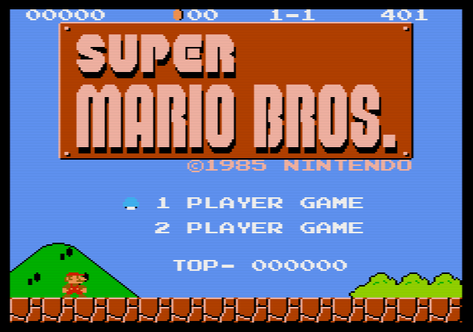
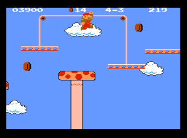
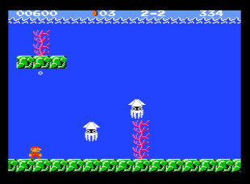
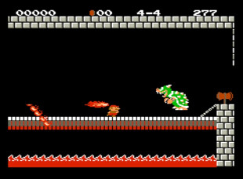

# Uzebox Super Mario Bros.

A faithful port of Super Mario Bros. (NES, 1985) to the [Uzebox](https://uzebox.org): the
6502 engine rewritten in C routine for routine, from
[doppelganger's disassembly](https://gist.github.com/1wErt3r/4048722), on a custom
video mode (17) that draws the NES's own 8×8 tiles and palettes.

<p align="center">
  
</p>

<p align="center">
  
  
  
</p>

<p align="center"><em>On the Uzebox: the title screen, then worlds 4-3, 2-2 and 4-4.</em></p>

## How it was made

- [The making of](ressources/MAKING-OF.md): the port's architecture, the memory and flash
  budgets, the SPI RAM and the SD card, the challenges and how they were solved.
- [Video mode 17](ressources/VIDEOMODE17.md): the custom video mode written for this game,
  how it draws the NES's tiles and sprites on the Uzebox, and its limitations.

## Bring your own ROM

**This repository holds no game data:** no graphics, music, levels or text to build from
(the screenshots above aside). All of it is extracted at build time from **your own** dump
of the cartridge.

1. Put your Super Mario Bros. `.nes` file in [`ROM/`](ROM/README.txt). Any name works.
   It must be the NES "World" / "Japan, USA" release (program CRC-32 `5cf548d3`).
2. In `default/`, run `make assets`. It checks the ROM and writes the levels, sound, texts,
   tables and tiles as include files in `data/`.
3. Run `make` (and `make uze`).

`.gitignore` lists the ROM and `data/`, so nothing made from the ROM can be committed by
mistake. You can also point to a ROM elsewhere: `make assets NES=path/to/rom.nes`.

How it works: `tools/romdata.map` names each data table the generators need (the
disassembly's label), its address in the ROM, and its layout. It holds no data bytes.
`tools/asmdata.py` reads the bytes from your ROM at those addresses.

## Building

Under MSYS2, with `avr-gcc` (proven on 14.2.0 and 16.2.0), GNU make and Python 3:

```sh
cd default
make assets   # once, after putting your ROM in ROM/
make          # uzebros.hex: standalone, for the whole 64 KB of flash (ISP programmer)
make uze      # uzebros.uze: for the bootloader (version 5.0.06 or later), with the game
              # for two players, the original title screen and the top score saved in EEPROM
```

The `.uze` reads its levels and music from its own file on the SD card at power-on, so keep
the card in.

## Layout

| | |
|---|---|
| `*.c *.h tiles17.s` | the game: the engine (`area.c player.c objects.c enemies.c bosses.c collide.c bgcoll.c sprites.c game.c`, the 6502's routines by name, `smb_ram.h` its RAM), the sound (`sound.c apu.c`), the platform layer on video mode 17 (`gfx17.c main17.c text.c bb.c`) and the `.uze`'s loader (`sd17.c`) |
| `customVideoMode17/` | video mode 17, and the generators of its tables |
| `kernel/` | the parts of the Uzebox kernel this game uses, with the game's changes (a vsync hook, a lean start-up, the game's own mixer) |
| `default/` | the Makefile and the build's passes (`tailjmp.py`, `tailmerge.py`, `shortcall.py`: smaller code; `bootjmp.py`, `ldorder.py`, `ramcheck17.py`: the link; `mkuze.py`: the `.uze`) |
| `tools/` | the generators that read your ROM |
| `data/` | what they write (not versioned) |
| `ROM/` | your ROM (not versioned) |

## License

GPL-3.0 (see `LICENSE`), like the Uzebox kernel. Super Mario Bros. is a trademark of
Nintendo; this project is not affiliated with or endorsed by Nintendo.
