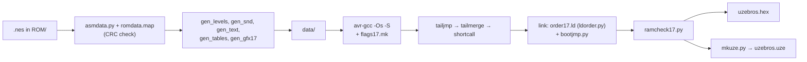

# The making of Super Uze Brothers

Super Uze Brothers is a port of Super Mario Bros. (NES, 1985) to the Uzebox: one ATmega644 at
28.6 MHz with 64 KB of flash, 4 KB of SRAM, an optional 128 KB SPI RAM chip and an SD card slot,
generating video and sound in software, cycle by cycle. This document explains how the port was
built, where the memory goes, how the `.uze` loads its data, what was hard, and how it was
tested. The video mode has its own document, [VIDEOMODE17.md](VIDEOMODE17.md).

---

## 1. Goals

- **A faithful port, not a remake.** The engine is the 6502 program rewritten in C one routine
  at a time, from doppelganger's disassembly (<https://gist.github.com/1wErt3r/4048722>). Each C
  function carries its 6502 label's name, so the two can be read side by side. Speeds, timers,
  collision quirks and the order of events within a frame are the original's. The rule was: when
  in doubt, follow the assembly, not your memory of the game.
- **The NES's own pixels.** A custom video mode, mode 17, draws the NES's 8×8 tiles at 1:1
  horizontally, with the NES's palettes and sprite list format.
- **Bring your own ROM.** The repository contains no graphics, music, levels or text from the
  cartridge. All of it is extracted at build time from the user's own `.nes` file (section 6).

**Two builds of one game:**

| | `uzebros.hex` (`make`) | `uzebros.uze` (`make uze`) |
|---|---|---|
| Installed with | an ISP programmer, the whole 64 KB | the bootloader, version 5.0.06 or later |
| Level data and music | in flash | in the file, loaded into SPI RAM from the card at power-on |
| Two-player game (Luigi) | no | yes |
| Title screen | slightly simplified | as on the cartridge |
| Top score kept in EEPROM | no | yes |

Both builds have the **title code**. On the title screen, enter Up Up Down Down Left Right Left
Right B A. When the last button is released, the power-up sound plays. From then on, B selects
the world, A the level, and a game starts with 99 lives, until the power is cut. Without the
code, the game is the cartridge's: 3 lives and no select. Lives of 10 or more are printed as two
digits instead of the cartridge's crown, which would have cost 22 bytes the standalone ROM did
not have.

---

## 2. Architecture

```
 ┌──────────────────────────── the engine: the 6502, in C ────────────────────────────┐
 │ area.c player.c objects.c enemies.c bosses.c collide.c bgcoll.c sprites.c game.c    │
 │        RAM: smb_ram.h (disassembly names)     registers: A_ X_ Y_ C_ Z_ N_          │
 └──────────────┬─────────────────────────┬──────────────────────────┬────────────────┘
                │ gfx.h                   │ sound queues             │ BBPtr, bb_*()
   ┌────────────▼────────────┐  ┌─────────▼─────────┐   ┌────────────▼────────────┐
   │ gfx17.c text.c main17.c │  │ sound.c → apu.c   │   │ bb.c: the block buffer  │
   │ tiles17.s               │  │ (SoundEngine, APU)│   │ in SPI RAM, SRAM cache  │
   └────────────┬────────────┘  └─────────┬─────────┘   └────────────┬────────────┘
        video mode 17                kernel mixer              kernel/spiram.s
```

### 2.1 The 6502's registers in CPU registers

Every 6502 subroutine becomes `void Label(void)`. Its inputs and outputs are the 6502's
registers and flags, which `smb.h` pins to AVR registers:

```c
register u8   A_ asm("r2");   register u8   X_ asm("r3");   register u8   Y_ asm("r4");
register bool C_ asm("r5");   register bool Z_ asm("r6");   register bool N_ asm("r7");
```

Every C file, the kernel's included, is compiled with `-ffixed-r2` to `-ffixed-r7`, so the
compiler never uses those registers for anything else. The kernel's interrupts preserve them, so
a "6502 register" costs a register move, not a RAM access.

A routine reads on entry what its original read. Before returning, it leaves in `A_`/`X_`/`Y_`,
and sets in `C_`/`Z_`/`N_`, what the original left, but only where a caller uses it after the
`jsr`. Inside a routine, ordinary C locals are used. Common idioms have fixed translations:

- a fall-through becomes a call at the end of the previous function;
- `JumpEngine` with its `.dw` table becomes a `switch`;
- stack tricks such as `pla pla` are rewritten to do what they mean.

`xcalls.h`, generated from the disassembly, declares every `jsr`/`jmp` target, so each module
could compile before the others existed.

### 2.2 RAM and the block buffer

**RAM.** `smb_ram.h` declares every variable under its disassembly name, in address order. The
6502 cleared RAM by address range (`InitializeArea` up to `$074B`, `InitializeGame` up to
`$076F`), so the variables are grouped into structs by those ranges, and each clear is one
`memset`. Per-object fields stay parallel arrays in the original slot order, indexed through
named offsets (`OFS_ENEMY`, `OFS_MISC`…) instead of the 6502's literal offsets. Two slot counts
are smaller to save SRAM: 6 misc slots instead of 9, and 1 air bubble instead of 3.

**The block buffer.** The 6502 keeps two 16-column buffers of 13 rows and reaches them through
`$06–$07` plus `y`. The port keeps a 32-column ring. `GetBlockBufferAddr()` points `BBPtr` at a
column, so `lda ($06),y` becomes `BBPtr[y >> 4]`. The `$02` byte keeps meaning "row × 16", as in
the assembly.

### 2.3 The virtual OAM

The engine's 64-sprite OAM is the video mode's sprite list itself: a 256-byte page of SRAM at a
fixed address, in the NES's format (Y, tile, attributes, X). Nothing is copied or converted. The
mode shows the list through an origin, the view's horizontal offset and the NES's line 24.

### 2.4 The platform layer

The engine reaches the screen only through `gfx.h`. The 6502's drawing routines are declared
there under their own names and implemented by the platform: the PPU and VRAM-buffer routines
(`WriteGameText`, `ReplaceBlockMetatile`, the status bar) and the sprite drawers
(`PlayerGfxHandler`, `EnemyGfxHandler`, `DrawFirebar`…). A layer never writes engine RAM. That is
why the engine's PC traces were identical on mode 16 and mode 17.

`gfx17.c` is mode 17's layer:

- **The picture.** It is 28 columns of 8 pixels, which is 224 of the NES's 256. There is one
  status bar row, then 24 playfield rows: block rows 0–11 of the engine's 13. The lowest ground
  row is below the picture.
- **No vertical camera.** Every level row stays in the same VRAM row.
- **Scrolling.** VRAM is a ring (level column `c` is VRAM column `c & 31`), so a scroll step
  writes one new column. The view follows the player within the NES screen, 0 to 32 pixels.
- **Changes wait for the commit.** While a level is shown, the engine's screen changes are
  queued. `gfx_Commit()` draws them together in the blank, with the scroll. It plays the role of
  the cartridge's VRAM buffer.

### 2.5 The frame loop

`main17.c` runs the frame in `main()`'s loop. The picture takes the CPU as one long interrupt, so
work it interrupts is simply suspended. Each pass:

1. **`show()`** uploads what the last engine frame asked for (palettes, a text screen), commits
   the screen changes and the scroll, and composes the sprites.
2. **`ReadControllers()`** reads the pad just before the engine runs, as on the NES.
3. **`game_Engine()`** runs one frame of the 6502's logic, sound engine included.

This is the cartridge's order: at the start of the blank, show the frame just computed, then
compute the next. The engine-first order was also built. Over 441,000 frames it repeated a frame
1.78% of the time; the cartridge's order did so 0.02% of the time.

`show()` starts only if it can finish before the next picture: the lines left must cover the
last `show()` plus a margin (26 lines, or 14 after a long one). Otherwise the loop waits a field,
and that picture shows the previous frame again, whole. The game may slow down, but a picture
never mixes two frames.

With the "picture in bands", a playfield row that is entirely black is left to the kernel's own
sync lines. The engine gets that time, about 12,400 cycles a row, but only while it writes
nothing the picture reads.

### 2.6 Sound

The kernel's music player is not linked. `sound.c` ports the 6502's whole `SoundEngine`, effects
and music, and writes emulated APU registers in `apu.c`. Once a vsync, `ProcessMusic()` runs one
NES frame of APU clocks (envelopes, sweeps, length counters) and sets the kernel mixer: pulse 1
and 2 on channels 0 and 1, the triangle on 2, the noise on 3. Its four waves (the 12.5%, 25% and
50% pulse duties and a 16-step triangle, 1,024 bytes) are generated. The reference,
`tools/sndmodel.py`, is the same engine in Python on a complete APU.

Two fixes improved fidelity:

- **Beating.** The mixer samples at about 15.7 kHz. A pulse slightly off a whole number of
  samples per cycle beat against its folded harmonics: the coin sound buzzed at 35 and 57 Hz.
  `pulse_step()` snaps such pitches, moving eight note periods by 1 to 7 cents.
- **High notes.** The 12 highest pulse notes, above about 1.5 kHz, play on the triangle wave,
  because a sampled square wave aliases too much there to stay in tune.

`ProcessMusic` is written in assembly to save flash. The sound engine runs once per engine frame,
so the music slows with the game.

`text.c` prints the messages as NES font tiles, taken from the ROM's own screen data
(`tools/gen_text.py`).

### 2.7 The build pipeline



- **`make assets`** checks the ROM and writes `data/`. This is done once.
- **Compilation.** Each engine object is compiled to assembly with its own extra flags from
  `flags17.mk`, the ones that made the linked ROM smaller, found by sweeping one object at a
  time.
- **Three assembly passes.** Each has a `--check` that proves it changed only what it claims to,
  and every build runs it.
  - `tailjmp.py` turns `call f; ret` into `jmp f`. Under `-mcall-prologues`, avr-gcc makes no
    tail calls at all.
  - `tailmerge.py` keeps one copy of each repeated instruction tail and replaces the others with
    `rjmp`. It first links the unpassed objects, to learn which functions the linker drops.
  - `shortcall.py` turns `call`/`jmp` to a function of the same object into `rcall`/`rjmp`
    where in reach.
- **The link.**
  - `order17.ld` places the three page-aligned tables (the mode's pair tables, the waves, the
    background tiles) back to back at 0x0100. `ldorder.py` merges it into the toolchain's linker
    script, because binutils 2.47 refuses `--section-ordering-file`.
  - `bootjmp.py` handles the reset vector (section 7.4).
  - `ramcheck17.py` prints the SRAM map, and fails the build if the stack gets under 190 bytes.

---

## 3. Memory

### 3.1 SRAM: 4,096 bytes

As `ramcheck17.py` prints it for the standalone build:

```
0x0100 ┌────────────────────────────────────────────┐
       │ mode 17's memory                      2,892│
       │   colour tables T1/T2 + status bar row 512 │
       │   sprite list = the engine's OAM       256 │
       │   VRAM: 24 rows × 32 columns           768 │
       │   38 RAM tiles + restore entries     1,330 │
       │   the mode's state                      26 │
       ├────────────────────────────────────────────┤
       │ game block at fixed addresses (tails17.h)  │ 328
       ├────────────────────────────────────────────┤
       │ .data 2 + .bss 683 (engine, kernel, sound) │ 685
       ├────────────────────────────────────────────┤
       │ stack                                      │ 191
0x10FF └────────────────────────────────────────────┘
```

`tails17.h` places the persistent, game and two area RAM structures, and the block buffer's
4-column cache, at constant addresses. As members of a struct in `.bss`, the same data would
cost 138 bytes more code. The sound engine's RAM is one 238-byte struct.

The stack's budget is 190 bytes: the engine's deepest frame, plus a picture interrupting it,
plus a margin. In the emulator's full check the deepest it went was 117 bytes during play and 133
at start-up; a serial test build on the console measured 124. A RAM tile costs 35 bytes, so a
39th was never affordable.

### 3.2 Flash

A `.uze` program is at most 61,440 bytes: the bootloader keeps the chip's last 4,096. Figures
for this repository built with avr-gcc 16.2.0 (the flash is `.text`, `.data`'s image and
`bootjmp.py`'s section):

| Build | Program | Limit | Free |
|---|---:|---:|---:|
| `uzebros.hex` | 65,414 | 65,536 | 122 |
| `uzebros.uze`, program | 61,278 | 61,440 | 162 |
| `uzebros.uze`, data after the program | 6,245 (13 sectors) | | |

The `.uze` file is 68,608 bytes. With avr-gcc 14.2.0, where the port was first finished, the
same sources came out about 120 bytes bigger: 65,534 bytes for the `.hex` (2 free) and 61,404
for the `.uze`'s program (36 free).

---

## 4. SPI RAM

| Where | What | Build |
|---|---|---|
| bank 0, 0x0000–0x01FF | the block buffer: 32 columns × 16 bytes | both |
| bank 0, 0x0200–0x03FF | the view: the level's metatiles as parsed, scenery included (on mode 17, the NES's name table) | both |
| bank 1, 0x7F00 and 0x7F10 | the waiting player's 15 bytes: lives, world, level, area, halfway page, coins, hidden 1-up flag, score | `.uze` |
| bank 1, from 0x7FFC | a 4-byte CRC, then from 0x8000 the level data, the music and the title board | `.uze` |

- **The block buffer** keeps four recently used columns cached in SRAM. `BBPtr` points into the
  cache, so the ported code reads `BBPtr[row]` as fast as the 6502 read `($06),y`. Writes go
  through `bb_Set()`, which updates the cache and the SPI RAM.
- **The two-player state.** On the cartridge the waiting player's bytes sit beside the active
  player's. Here they are parked in SPI RAM, and `TransposePlayers` swaps them (`bb_Park()`).
  SRAM had 3 bytes free.
- **The `.uze` data** is read with `sd_byte(p)`, which is `SpiRamReadU8(1, (u16)p)` (section
  6.2).

**Sharing the bus with the card.** The SPI RAM and the SD card share the SPI bus, and `sd17.c`
follows rules partly found on real hardware:

- **Clocks.** The SPI RAM runs at the full clock (F_CPU/2). The bootloader's SD calls expect
  F_CPU/8. Every bootloader call goes through `card()`, which sets the card's clock, calls,
  deselects the card (PD6 high), and restores the full clock.
- **SPIF.** The SPI RAM routines leave SPIF set, and the bootloader's code waits on it, so
  `card()` clears it before every call.
- **No open transfers.** An SPI RAM transfer is never left open across a card call. The chip
  selects are PA4 for the RAM and PD6 for the card.

---

## 5. The `.uze` and the SD card

### 5.1 Why the data lives on the card

The full game did not fit in 61,440 bytes, so the 68 level-data blocks (4,461 bytes) and the
music (1,520) moved into the `.uze` file, after the program. The loader cost 799 bytes and the
engine's indirect reads 134. The program dropped to 60,430 bytes, and the room left paid for the
extras:

| Extra | Bytes |
|---|---:|
| the two-player game | 352 |
| the original title | 180, plus 264 bytes of board on the card |
| the EEPROM top score | 372 |
| the title code | 114 |

Two alternatives were measured. Linking a generic SD library instead of calling the bootloader
would have fitted only the game without its extras. Compressing data into SPI RAM was mostly a
saving on tiles, which mode 17 cannot use: it reads its tiles from flash on every scanline.

### 5.2 The `.sddata` trick

In the `.uze` build, the level tables, the music and the title board go into a linker section,
`.sddata`, at data address 0x808000, where no memory exists. A pointer to a level block is then
0x8000 plus its offset, which is exactly where the loader puts that byte in SPI RAM bank 1. No
address table is written by hand. The code reads through a macro that is `pgm_read_byte` in one
build and `sd_byte` in the other. The `.hex` given to the bootloader leaves `.sddata` out.

### 5.3 The file

`default/mkuze.py` builds the file:

```
sector 0        the .uze header; bytes 8–11 give the program's size
sectors 1..k    the program, its last sector padded with 0xFF
sector k+1      the data's CRC-32 (4 bytes), then the data, padded to a whole sector
```

The bootloader programs only what the header says, so the data is never flashed. The link
receives the CRC-32 as two symbols, which binds the program to its data. `mkuze.py --check`
reads the finished file back against the ELF.

### 5.4 Finding its own file

The bootloader does not tell the game which file it came from: on a normal power-on it starts the
program in flash without opening any file. So the game searches the card, **whatever the file is
called**. A fixed name would break when the file is renamed. A cluster number saved in EEPROM
would break on another card.

Bootloaders from version 5.0.06 have a table of SD and FAT entry points at 0xF000. The game calls
them as C functions, and no SD library is linked. The search (`load()` in `sd17.c`):

1. Check the bootloader's signature and version, then mount the card.
2. Walk the root directory, 16 entries a sector.
3. Skip without reading: deleted entries, directories, labels, long-name parts, non-`UZE`
   files, files that are not a whole number of sectors, and files under 3 sectors. A normal
   `.uze` is its header and program to the byte, so almost every other game is skipped here.
4. Open a candidate, step to the sector after its program, and compare the first 4 bytes with
   the CRC. On a match, copy the data into SPI RAM; otherwise go on.

An older build left on the card is never taken, because its CRC differs. The search is 340 bytes
of code. Its 512-byte buffer is borrowed from the RAM tiles, unused before the first frame.

In the emulator, the search takes about 48 ms with the game alone on the card. Each 16 directory
entries before it add about 10 ms, and each other data-carrying `.uze` about 43 ms. Copying the
13 data sectors takes 150–220 ms more. These figures were not measured on a console.

### 5.5 Faults and the top score

Without its data there is no game. A message is centred on a black screen, and the load is
retried twice a second, so inserting a card starts the game. The messages are:

- `BOOTLOADER 5.0.06 NEEDED`
- `NO SD CARD`
- `CARD IS NOT FAT16 OR FAT32`
- `GAME FILE NOT ON THE CARD` (also shown for an older build)
- `CARD READ ERROR`

On the console, the bootloader programmed the `.uze` and the game ran from a 2 GB FAT16 card and
from an SDHC FAT32 card.

**The top score** is saved in a kernel EEPROM block with ID **0x5342**; its first six bytes are
the digits. It is read at power-on and written only during a screen set-up, while the screen is
off. Writing a byte takes about 3.4 ms, so the game never writes during a level. The kernel's
smaller routines (`EepromBlockExists`, `ReadEeprom`, `WriteEeprom`) are used; the block-level
ones would have cost about 150 bytes more.

---

## 6. Bring your own ROM

- **`tools/romdata.map`** lists every data table the generators use: the disassembly's label,
  its address in the ROM's program, and its shape (bytes, words or label references). It holds
  no data, and begins with the expected program CRC-32.
- **`tools/asmdata.py`** finds the `.nes` (in `ROM/`, or given with `NES=`), checks the CRC, and
  returns each table as the disassembly's `.db`/`.dw` lines would.
- **The generators** write `data/`:

| Generator | Output |
|---|---|
| `gen_levels.py` | `levels.h`: area and enemy data and their pointer tables, verbatim, for the ported parser |
| `gen_snd.py` (`sndmodel.py`) | `snddata.inc`, `waves.inc`: music and effects in the NES's layout, mixer volume tables, the four waves |
| `gen_text.py` | `textdata.h`: the messages as font tile numbers |
| `gen_tables.py` | `romtables.h`: scenery, metatiles, enemy graphics, physics, demo inputs, as macros the C files expand |
| `gen_gfx17.py` | tiles in mode 17's format (one 32-byte flash tile per tile-and-palette pair drawn), the 256 sprite tiles and their opaque boxes, metatile tables, the title board, colours (`nespal.py` picks the nearest Uzebox colour) |

`.gitignore` lists `ROM/` and `data/`, so nothing made from the cartridge can be committed by
mistake. A build without `data/` stops and says why. The supported dump is the NES "World" /
"Japan, USA" release: 40,976 bytes, PRG CRC-32 `5cf548d3`, CHR CRC-32 `867b51ad`.

---

## 7. Challenges

### 7.1 Fitting in the flash

| Stage | ROM (bytes) |
|---|---:|
| music added, on mode 16 | 66,793 (1,257 over the chip) |
| after a second hand-shrink pass on every module, and tail calls | 63,625 |
| first mode 17 build (the NES's tiles are about 11.4 KB) | 65,046 |
| full version with the title demo and the reset jump | 65,482 |
| final standalone (avr-gcc 14.2.0; 65,414 with 16.2.0) | 65,534 |

What made the room:

- **Smaller data.** The port's own sound engine with just four waves replaced the kernel's
  player. Identical tiles are stored once, and only tiles the game draws are stored.
- **Hand shrink passes**, module by module, each keeping the engine's behaviour bit for bit
  (section 8). They took 17–35% off a module. The techniques that paid:
  - set flags only where a caller reads them;
  - load array elements into locals;
  - use `u8` arithmetic to avoid promotion to `int`;
  - merge near-identical routines;
  - turn switch ladders into PROGMEM tables.
- **Compiler options.** `-ftoplevel-reorder` and `-fno-split-wide-types` saved 1,024 and 208
  bytes, and the per-object flags 564. `-flto` made the ROM bigger, `-Oz` was no smaller than
  `-Os`, and some 25 other flags gave 1% or less each.
- **The assembly passes.** `shortcall.py` saved 968 bytes and `tailmerge.py` 332, without
  slowing the engine's frame. `tailjmp.py` also made frames faster.
- **The link order** cut alignment padding from 308 bytes to 6.
- **Removing things.** The kernel's UART went, which also returned the 2.4% of CPU time its
  per-line polling had taken. A wider head-collision test left from mode 16 went (86 bytes). The
  `.uze` extras stay out of the `.hex`.

### 7.2 A cycle-counted kernel: never `-mrelax`

The kernel and the mode are timed to the cycle, so no instruction may change size behind their
back. Linker relaxation is forbidden, and the Makefile rejects any assembly object built for it.
That is why `shortcall.py` exists. It shortens only calls inside the game's own C objects, never
into the kernel, the mode, the C library, or SPI RAM routines that count cycles from their
caller's 4-cycle `call`.

### 7.3 Sprites, RAM tiles and flicker

Mode 17 draws a sprite by composing it into a RAM tile that replaces the background cell under
it. A sprite off the 8-pixel grid covers 4 cells, so cells, not sprites, are the cost. There are
38 RAM tiles, and a composition draws at most 24 sprites. Beyond either limit, sprites take
turns.

At first the tiles were handed out from wherever the last frame ran short, and the gap walked
through the list until Mario lost pieces for frames at a time. The fix was **three classes**:

1. the player's 8 entries are always first;
2. brick chunks and floating scores, marked by a bit in their tile data, are last;
3. everything else goes between.

After that, Mario no longer flickered.

Other fixes made composition cheaper:

- A sprite behind the background that cannot show, such as a piranha plant in its pipe, takes no
  tile. In one 6-2 play, two-field frames fell from 136 of 545 to 1.
- A "behind" sprite over the blank sky is drawn as a front sprite.
- A speed session reworked both compositor passes and added the picture in bands. The worst
  blank in five reference scenes fell from 48–62 lines (of 62) to 14–44.

### 7.4 The bootloader fuse

Most Uzeboxes have the bootloader's fuse set (high fuse 0xD2), so the chip resets at 0xF000. A
ROM over 61,440 bytes flashed by a programmer has its own code there; one build started inside a
`sound.c` routine. `bootjmp.py` links a `jmp 0` at 0xF000. The linker cannot place code around a
fixed address without splitting `.text`, so only data goes above the jump. The script links once,
picks from the map the PROGMEM tables that best fill 0xF004 to the end of flash (53 tables,
4,092 bytes), relinks with an extra `.bootjmp` section, and checks the result. It was confirmed
on a console with the fuse at 0xD2.

### 7.5 Lifts

A large lift is six identical girder sprites. The cartridge places the endlessly moving lifts
12 pixels right of their column, 4 pixels off the cell grid, so each lift covered 14 of the 38
RAM tiles, and pieces vanished at the end of 1-2. The fix:

- on mode 17 those lifts sit on the grid, 16 pixels instead of 12 (an engine change the author
  approved);
- over blank cells, one segment is composed and the other columns reuse its tiles.

A lift now costs 2 RAM tiles, and in 1-2 the frames short of a tile fell from 83 to 5.

### 7.6 The title board and the tile window

A VRAM cell reaches 192 flash tiles at a time, through a window set per screen area. The
generator orders the 248 background tiles so each scene fits one window: one for the levels, one
for the font and the areas that show text.

The cartridge's title board did not fit in the text window. In the `.hex`, two board tiles are
drawn as their nearest neighbours (4 pixels differ), the copyright and two-player lines are left
out, and the view starts 16 pixels in to centre the board. The `.uze` draws the board as on the
cartridge: 13 more tiles bring the table to 261, the title gets a window of its own, and its 242
cells are stored on the card.

### 7.7 Timing

The picture takes the CPU for 200 lines, which leaves a blank of about 112,840 cycles (about
93,000 after the sync interrupts) for the commit, the composition and the engine. When measured,
the composition alone could take up to 94,000 cycles. Section 2.5 covers how the loop handles
this. A cap that dropped to 18 sprites after a late frame was tried, but it made enemies take
turns in scenes that would have fit, and the cap went back to 24.

### 7.8 Fidelity fixes

- **The lives screen.** The player's corner tile took its palette from the next sprite entry,
  which on the cartridge had just been cleared; it now uses the cartridge's value.
- **Level 2-1's enemy list** gets its missing terminator from the generator.
- **The status bar** now changes world and level when the 6502 rewrites that line.
- **The title cursor** uses the board's palette.
- **The second pad port** is ignored unless it reads as a pad, after a keyboard dongle there
  blocked the title.

---

## 8. How it was verified

A faithful port needs something to be faithful *to*. The approach was to build a chain of
references, each layer checked against the one below it, so that any change (a shrink pass, a
faster compositor, a new compiler) could be proven not to have changed the game.

### 8.1 The engine on the PC: the reference

The engine's C files compile for the PC as well as for the AVR: the same sources, with small
stand-ins for the kernel and the video. Because every routine keeps the 6502's name and its
register convention (section 2.1), a routine can be read side by side with the disassembly,
and the PC build can be run as fast as the host allows.

The PC build plays scripted and randomized sessions on every level and writes, each frame, a
hash of the whole game RAM, the block buffer and the OAM. Those traces are the baseline: every
hand-shrink step and every refactor had to reproduce them exactly (25 scenarios, 121,000 frames).
The same PC build also draws each frame through a model of the video mode and compares it, pixel
for pixel, with what the NES's own rules give with the cartridge's tiles (190,336 frames).

### 8.2 The emulator: a CUzeBox fork with a GDB stub

The ROMs themselves were run in a fork of Jubatian's CUzeBox emulator, extended for this kind of
work:

- **A GDB server** (the GDB Remote Serial Protocol over TCP). `avr-gdb` connects from the command
  line, VS Code or Eclipse: breakpoints, single steps, registers, SRAM and flash, with the
  game's symbols from the `.elf`. Emulator-specific features are `monitor` commands, so any
  GDB front end can use them: advance an exact number of frames (`monitor frames <n>`), read or
  write the SPI RAM (`monitor spiram read`), save and load the whole machine's state.
- **Input capture and replay.** Every vsync's buttons are written to a file, and a session
  replays exactly from reset, on the same ROM or on a newer build.
- **Recording.** Picture and sound to a video file, frame-by-frame stepping forwards and
  backwards, and quick save states.
- **An SD card from a host folder**, so the version 5 bootloader can program the `.uze` and the
  game can load its data, as on a console.

Two ways of using it mattered most:

- **Lockstep against the PC.** A script runs the real ROM under the GDB stub, stops it at every
  game frame, reads its RAM and compares it with the PC engine's trace for the same input. On the
  `.uze`'s ROM: 105 scenarios, 446,000 frames, every one equal, and none longer than a field.
  The video mode's compositor was checked the same way, against its model, on test ROMs (951
  hand-built compositions: sprites touching, overlapping, flipped, at the edges, behind art).
- **Recorded runs for bugs.** Play-testing was done in recorded sessions, with a debug build
  showing the frame counter in place of the score. A problem was reported as "run *n*, frame *f*";
  the run's buttons replay the bug exactly, `avr-gdb` attaches at that frame, and the same run
  replays on the fixed build to show the fix.

The loader was tested in the emulator too: the bootloader programs the `.uze` from the emulated
card, the SPI RAM is compared byte for byte with the link, and every fault message (no card, no
version 5 bootloader, a card that is not FAT, no file, a failed read) is triggered on purpose.

### 8.3 On the console

A serial build takes the pad's input over the UART instead of from the pad, and every 64 frames
sends back a checksum of the engine's RAM. Replaying recorded plays that way on real hardware
(13 plays, 50,400 frames, at 59.5 to 59.9 frames per second) matched the PC every time. The
rest was play-testing on the console itself.

### 8.4 Reproducible builds

The same sources give the same `.hex`, byte for byte. A change that should not touch the code
(a comment, a moved file, a cleaned-up Makefile) is proven by comparing the hashes of the two
ROMs. That is how this repository's own clean-up was checked.

The debug builds and test tools described here were development aids; this repository keeps the
game and what builds it.

---

## 9. Limitations and known issues

- **Sprites take turns in busy scenes**: firebars and small lifts in 5-4, a Bullet Bill in 8-3,
  and big Mario, enemies, chunks and scores together in 1-1 and 1-2. The player never gives way.
- **Slowdown is accepted.** In the busiest places a frame is shown twice rather than drawn wrong
  or black, and the music slows with it.
- **The picture is 224 × 200.** It shows 224 of 256 columns and not the lowest ground row. The
  status bar is one row, so the two-player game has no line for the names.
- **The endlessly moving lifts sit 4 pixels right of the cartridge's position.**
- **The `.uze` needs** the SPI RAM, a 5.0.06 or later bootloader, and the card in the slot at
  every power-on, with the file in the root directory. Its start-up search grows with the number
  of files on the card.
- **The `.hex`** has no two-player game, no saved score, and a simplified title.
- **Untested on a console** when the notes were written: the `.uze`'s two-player game and
  original title (tested on the PC and in the emulator), and a card inserted with the power on.
- **A 6502 quirk.** With `PlayerFacingDir` at 0, which happens only right after a RAM clear, a
  climbing-table read runs 255 bytes past its table, as on the NES, and reads whatever flash
  follows. It has been harmless so far.

---

## 10. The video mode

Mode 17 is described in **[VIDEOMODE17.md](VIDEOMODE17.md)**: pair codes and colour tables, flash
tiles and RAM tiles, the compositor's passes, the picture in bands, and the timing.

---

*Super Mario Bros. is a trademark of Nintendo. This project is not affiliated with or endorsed
by Nintendo. Dump the ROM from a cartridge you own.*
